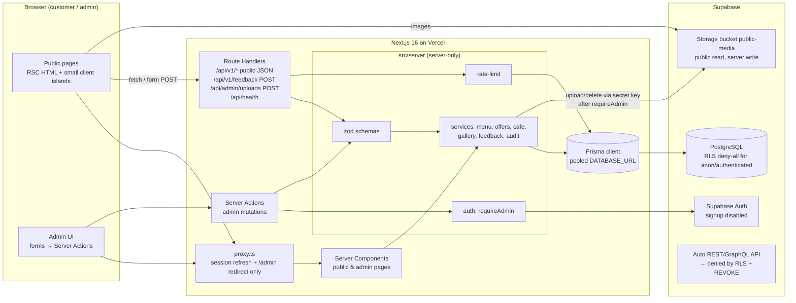
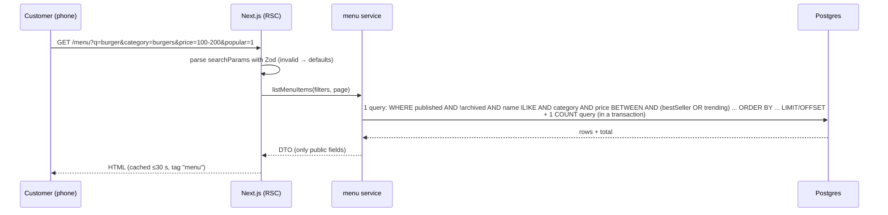
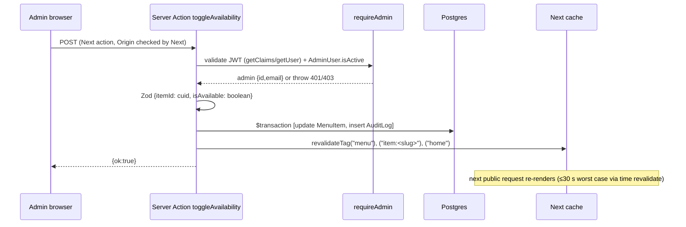
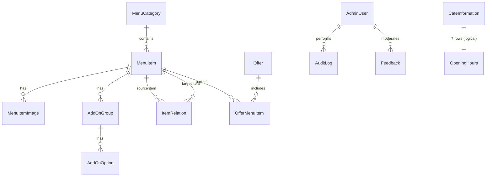
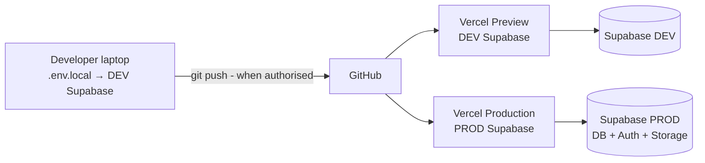

# TRD — Technical Requirements & Design

**Version:** 1.0 (Phase 1), 2026-10-13. Versions are listed in DECISIONS ADR-002 and pinned in Phase 2.

## 1. Stack and rationale

| Layer | Choice | Why |
|---|---|---|
| Web framework | Next.js 16 App Router, React 19, TypeScript strict | Matches the synopsis flowchart (Next.js backend: API routes / Server Actions). One codebase for SSR pages and API; deploys natively on Vercel. |
| Styling | Tailwind CSS 4 (`@theme` tokens from UI_SPEC) | Stitch design is Tailwind; tokens carry over 1:1. |
| Icons / fonts | lucide-react; `next/font` (Sora, Plus Jakarta Sans) | CLAUDE.md §5; no runtime Google requests. |
| Validation | Zod 4 | One schema validates on both client (UX) and server (authority). |
| ORM | Prisma 7 + `@prisma/adapter-pg` | Synopsis flowchart; type-safe queries; migrations in Git. |
| Database | PostgreSQL on Supabase (separate dev and prod projects) | Synopsis flowchart; managed backups; auth and storage in the same platform. |
| Auth | Supabase Auth (email+password) via `@supabase/ssr`, plus `AdminUser` allowlist | CLAUDE.md §4.1; no custom password storage. |
| Storage | Supabase Storage, public-read bucket `public-media`, server-only writes | CLAUDE.md §5. |
| Image processing | `sharp` | Validate and re-encode uploads (ADR-015). |
| QR | `qrcode` | Server-side SVG/PNG. |
| Rate limit | Postgres table via Prisma | Shared across serverless instances (ADR-014). |
| Tests | Vitest + React Testing Library; Playwright (+ @axe-core/playwright); Lighthouse CLI | CLAUDE.md §5, §10. |
| Hosting | Vercel (app) + Supabase | CLAUDE.md §5. |

## 2. Architecture

### 2.1 Data flow — public menu request

### 2.2 Data flow — admin availability toggle

## 3. Module responsibilities (`src/`)

| Path | Responsibility |
|---|---|
| `app/(public)/…` | Public routes; Server Components; `generateMetadata`; `loading.tsx` / `error.tsx` / `not-found.tsx`. |
| `app/(admin)/admin/…` | Admin routes; the layout calls `requireAdmin()` (redirects to login); pages are dynamic and never cached. |
| `app/api/v1/…` | Public JSON API (GET), feedback POST. |
| `app/api/admin/…` | Uploads POST and logout POST (Origin check + `requireAdmin`). |
| `app/api/health/route.ts` | Health check (`SELECT 1`, version, no secrets). |
| `proxy.ts` | Refresh the Supabase session cookie; redirect unauthenticated `/admin/*` (except `/admin/login`) to login. **Not an authorization boundary.** |
| `server/auth/` | `getSessionUser()`, `requireAdmin()`, `AuthError` types. |
| `server/services/` | Business logic per domain. The only place that imports Prisma. Returns DTOs. |
| `server/db.ts` | Prisma client singleton with the pg adapter (`import "server-only"`). |
| `server/storage.ts` | Supabase Storage admin client (secret key; server-only). |
| `server/rate-limit.ts` | Postgres fixed-window limiter. |
| `server/audit.ts` | `recordAudit(tx, …)`. |
| `server/revalidate.ts` | Maps entity changes to tags/paths. |
| `lib/validation/` | Zod schemas shared with client forms (no server imports). |
| `lib/config/env.ts` | Zod-validated env; separate `serverEnv` (server-only) and `publicEnv`. |
| `lib/format.ts` | `formatRupees(paise)`, IST date helpers, `offerStatus()`, `isOpenNow()` (pure, unit-tested). |
| `lib/http.ts` | `ok()`, `fail()`, `ApiError` → consistent JSON responses; `assertSameOrigin()`. |
| `components/`, `features/` | UI (UI_SPEC §16). Never import `server/*` from client components. |

## 4. Database schema

Prisma models, summarised. All IDs are `String @id @default(cuid())`; every model has `createdAt @default(now())` and `updatedAt @updatedAt` unless stated. Money is `Int` paise. `isDemo Boolean @default(false)` is on content models. Text lengths are enforced by Zod and by `@db.VarChar(n)`.

| Model | Key fields | Constraints / indexes |
|---|---|---|
| **MenuCategory** | name (60), slug (70), description? (200), iconKey (enum list), sortOrder Int, isArchived Bool | `slug` unique; index (isArchived, sortOrder) |
| **MenuItem** | categoryId FK, name (80), slug (90), description (600), pricePaise Int (>0), dietType enum VEG/NON_VEG/EGG, isAvailable Bool, isPublished Bool, isArchived Bool, isBestSeller, isTrending, isFeatured Bool, sortOrder Int | `slug` unique; FK `onDelete: Restrict`; index (isPublished, isArchived, categoryId, sortOrder); index (isBestSeller, isTrending); index (pricePaise); `pg_trgm` GIN index on `lower(name)` (added in the SQL migration if needed for ILIKE speed; small dataset, optional) |
| **MenuItemImage** | menuItemId FK, storagePath (200), altText (150), sortOrder Int | FK cascade; max 4 per item (service-enforced); unique (menuItemId, sortOrder) |
| **AddOnGroup** | menuItemId FK, name (60), minSelect Int ≥0, maxSelect Int ≥1, isRequired Bool, sortOrder | FK cascade; CHECK minSelect ≤ maxSelect (SQL) |
| **AddOnOption** | groupId FK, name (60), priceDeltaPaise Int ≥0, isAvailable Bool, sortOrder | FK cascade |
| **ItemRelation** | fromItemId FK, toItemId FK, type enum RELATED/FREQUENTLY_BOUGHT_TOGETHER, sortOrder | unique (fromItemId, toItemId, type); CHECK from ≠ to; FKs cascade |
| **Offer** | kind enum DISCOUNT/COMBO/INFO, title (80), slug (90), description (600), imagePath?, promoPricePaise Int?, startsAt DateTime, endsAt DateTime, expiredAt DateTime?, isPublished, isStudentOffer, isFeatured Bool, sortOrder | `slug` unique; index (isPublished, startsAt, endsAt); CHECK endsAt > startsAt; CHECK promo null iff kind=INFO |
| **OfferMenuItem** | offerId FK, menuItemId FK, quantity Int 1–20 | PK (offerId, menuItemId); offer cascade; item Restrict |
| **PromotionalBanner** | title (80), subtitle? (160), imagePath, altText (150), ctaLabel? (30), ctaHref? (300), startsAt?, endsAt?, isPublished, sortOrder | index (isPublished, sortOrder) |
| **CafeInformation** | singleton id="cafe"; name, addressLine (200), city, postalCode, phone?, email?, whatsappNumber? (E.164 digits), instagramUrl?, facebookUrl?, latitude? Decimal(9,6), longitude? Decimal(9,6), aboutText?, studentZoneText?, offerTerms?, isPureVegConfirmed Bool, `verified*` booleans per field group | CHECK lat −90…90, lng −180…180 |
| **OpeningHours** | dayOfWeek Int 0–6 (0=Sun), opensAtMin Int 0–1439, closesAtMin Int 1–1440, isClosed Bool | unique (dayOfWeek); CHECK opens < closes unless closed (past-midnight hours: Q-05, not supported now) |
| **GalleryImage** | storagePath, altText (150), caption? (120), sortOrder, isPublished | index (isPublished, sortOrder) |
| **Feedback** | displayName? (40), message (1000), status enum PENDING/APPROVED/REJECTED, moderatedAt?, moderatedById? FK AdminUser | index (status, createdAt) |
| **AdminUser** | authUserId (uuid, unique, = Supabase `auth.users.id`), email (unique), displayName?, isActive Bool, lastLoginAt? | — |
| **AuditLog** | adminUserId? FK (SetNull), action (enum-like string), entityType, entityId?, summary (300), createdAt | index (createdAt desc), (entityType, entityId); no updatedAt (append-only) |
| **RateLimitBucket** | key (64, HMAC hex), scope, windowStart DateTime, count Int | unique (key, windowStart); index (windowStart) for pruning |

**Delete and archive behaviour:**
- Categories and items are soft-archived. A hard delete is allowed only with zero references (OfferMenuItem / ItemRelation) and is protected by `Restrict` FKs.
- Offers, banners and gallery images are hard-deletable (with confirmation), and their storage objects are removed.
- Feedback can be deleted.

**Pagination:** offset (`skip/take`) with a total count; the catalogue is small (<500 items), so offset is simple and correct. Admin lists also use offset.

**ER diagram:**

**Migrations:**
- `prisma migrate dev` is used on the **development** project only.
- `prisma migrate deploy` runs on production, only with written approval (rule 14).
- A hand-written SQL migration `…_security_rls` enables RLS on all tables, revokes privileges from `anon`/`authenticated`, and adds the CHECK constraints listed above.
- Migrations use `DIRECT_URL`; runtime uses the pooled `DATABASE_URL`, configured in `prisma.config.ts` per Prisma 7 docs (verified in Phase 3).

## 5. Auth and authorization design

1. **Login** (`/admin/login`, Server Action):
   - Zod validates `{email, password}`.
   - Rate limit (IP+email, and IP).
   - `supabase.auth.signInWithPassword` on the server via `@supabase/ssr`, which writes the cookies.
   - Then `requireAdmin()`. If the user is not on the allowlist, sign them out immediately and show the same generic error.
   - Audit `LOGIN`.
2. **`requireAdmin()`:**
   - Create the server client from cookies.
   - `getClaims()` verifies the JWT signature and expiry; fall back to `getUser()` if needed.
   - Look up `AdminUser` by `authUserId = sub` with `isActive = true`.
   - Return `{adminId, email}`; otherwise throw `Unauthorized` (no or invalid session) or `Forbidden` (not an admin).
   - **Never uses `getSession()` alone.**
3. **Where it runs:**
   - In the `(admin)` layout (page access).
   - At the top of **every** admin Server Action and admin Route Handler (operation access).
   - The proxy only refreshes the session and redirects.
4. **Logout:** POST `/api/admin/logout` (Origin check) → `supabase.auth.signOut()` (revokes the refresh token) → clear cookies → audit `LOGOUT` → redirect.
5. **Session expiry:** an expired token makes `requireAdmin` fail. Server Actions return `{error:"SESSION_EXPIRED"}` and the client shows a toast and redirects to `/admin/login?next=<internal path>`. `next` is validated: it must start with `/admin` and not with `//`.
6. **Provisioning:** first admin per DEPLOYMENT.md §6; `npm run admin:grant -- --email <email>` (server script; uses `DIRECT_URL` and the Supabase secret key to look up the user ID; never creates passwords).

## 6. API contracts

**Conventions:**
- Success: `{ "data": …, "meta"?: {page, pageSize, total, totalPages} }`.
- Error: `{ "error": { "code": "VALIDATION_ERROR"|"NOT_FOUND"|"UNAUTHORIZED"|"FORBIDDEN"|"RATE_LIMITED"|"PAYLOAD_TOO_LARGE"|"BAD_ORIGIN"|"INTERNAL", "message": "<safe text>", "fields"?: {name: msg} } }`.
- `Content-Type: application/json`; prices are returned as `pricePaise` (integer) **and** `priceLabel` (`"₹149"`); dates are ISO 8601 UTC.
- Unknown query params are ignored; invalid values give 400. Request bodies use `.strict()`, so unknown fields give 400.

| Method & path | Auth | Request | Response `data` | Errors |
|---|---|---|---|---|
| GET `/api/health` | — | — | `{status:"ok", db:"ok"\|"down", version}` | 503 when DB down |
| GET `/api/v1/home` | — | — | `{banners[], categories[], trending[≤4], featuredCombo?, studentOffers[≤2], reviews[≤3], gallery[≤6], cafe, hoursToday}` | 500 |
| GET `/api/v1/categories` | — | — | `[{id, slug, name, iconKey, itemCount}]` | 500 |
| GET `/api/v1/menu` | — | `q`(≤60), `category`(slug), `minPrice`,`maxPrice`(int ₹ 0–100000), `popular`(`1`), `offers`(`1`), `sort`(`popular`\|`price_asc`\|`price_desc`\|`name`), `page`(≥1), `pageSize`(1–48, default 12) | `[MenuItemCard]` + meta | 400 invalid params |
| GET `/api/v1/menu/[slug]` | — | slug `^[a-z0-9-]{1,90}$` | `MenuItemDetail` (images, addOnGroups, related[], fbt[], combos[], activeDiscount?) | 400, 404 |
| GET `/api/v1/offers` | — | `kind`?, `student`(`1`)? | `{active[], scheduled[]}` (never expired) | 400 |
| GET `/api/v1/offers/[slug]` | — | slug | `OfferDetail` | 404 (incl. expired/unpublished) |
| GET `/api/v1/cafe` | — | — | `{name, address…, phone?, email?, whatsappUrl?, socials, lat?, lng?, hours[7], openNow, texts, isPureVegConfirmed}` | 500 |
| GET `/api/v1/gallery` | — | `page`,`pageSize` | `[{id, url, altText, caption?}]` + meta | 400 |
| GET `/api/v1/reviews` | — | `page`,`pageSize`(≤20) | `[{id, displayName\|"Guest", message, createdAt}]` (APPROVED only) | 400 |
| POST `/api/v1/feedback` | — (Origin check) | `{displayName?, message, website:""}` (honeypot), ≤8 KB | `{status:"PENDING"}` 201 | 400, 403 BAD_ORIGIN, 413, 429 |
| POST `/api/admin/uploads` | admin + Origin | multipart `file` (≤5 MB), `purpose` (`item`\|`gallery`\|`banner`\|`offer`) | `{storagePath, width, height}` 201 | 400, 401, 403, 413, 415, 429 |
| POST `/api/admin/logout` | session + Origin | — | 303 → `/admin/login` | 403 |

**Admin Server Actions** (all: `requireAdmin` → Zod `.strict()` → service in a transaction → audit → revalidate → `{ok:true, data?}` or `{ok:false, error:{code, message, fields?}}`):

`category.create/update/archive/unarchive/delete/reorder` · `item.create/update/archive/unarchive/delete/setAvailability/setFlags` · `item.images.attach/reorder/updateAlt/remove` · `item.addOns.save` (replaces the groups of one item in one transaction) · `item.relations.add/remove` · `offer.create/update/publish/expire/delete` · `banner.create/update/reorder/delete` · `cafe.update` · `hours.update` · `gallery.attach/update/reorder/delete` · `feedback.approve/reject/delete` · `audit.list` (read).

**DTO rule:** services return explicit `select`ed fields only. Internal flags (`isDemo` excepted), audit data and admin IDs never appear in public DTOs.

## 7. Validation and error handling

- Zod schemas live in `lib/validation/*` (for example `menuQuerySchema`, `itemInputSchema`, `feedbackSchema`, `bannerSchema` with `safeHref`, `cafeSchema` with `httpsUrl`, `latitude`, `longitude`, `e164Digits`).
- Strings are trimmed and length-limited; control characters are stripped from free text; rich text is not accepted.
- **Error mapping:**
  - Zod → 400 with `fields`.
  - Prisma `P2002` → 409 "already exists" (slug).
  - Prisma `P2025` → 404.
  - Prisma `P2003` → 409 "in use".
  - Anything else → 500 "Something went wrong".
- Logs carry `{requestId, route, code}`; no bodies, cookies or tokens.
- UI pages use `error.tsx` boundaries with a retry button and `not-found.tsx`.

## 8. Environment configuration

Validated at startup by `lib/config/env.ts`; the app fails fast with a clear message naming the missing variable (never its value).

| Variable | Scope | Purpose |
|---|---|---|
| `DATABASE_URL` | server | Supabase pooled (transaction mode) connection for runtime |
| `DIRECT_URL` | server (CLI/scripts) | Direct/session connection for migrations |
| `NEXT_PUBLIC_SUPABASE_URL` | public | Supabase project URL |
| `NEXT_PUBLIC_SUPABASE_PUBLISHABLE_KEY` | public | Publishable key (or legacy anon key; whichever the dashboard provides; recorded in Phase 3) |
| `SUPABASE_SECRET_KEY` | **server only** | Secret key (or legacy service_role) for Storage writes and the provisioning script; never `NEXT_PUBLIC_` |
| `NEXT_PUBLIC_SITE_URL` | public | Canonical URL, QR target, Origin allowlist; https in production |
| `RATE_LIMIT_SALT` | server | HMAC key for rate-limit keys (≥32 random bytes) |
| `SUPABASE_STORAGE_BUCKET` | server | Default `public-media` |
| `ALLOW_DEMO_SEED` | scripts | Must be `true` for the seed to run; never set in production |

## 9. Storage

- **Bucket:** `public-media` (public read).
- **Paths:** `items/<itemId>/<uuid>.webp`, `gallery/<uuid>.webp`, `banners/<uuid>.webp`, `offers/<uuid>.webp`.
- No Storage RLS insert/update/delete policies exist for `anon`/`authenticated`, so clients cannot write. The server writes with the secret key after `requireAdmin` and validation.
- `next/image` `remotePatterns` allows only `<project>.supabase.co/storage/v1/object/public/public-media/**`.
- When a database row is deleted, the server deletes its object; if that fails, the error is logged and reported in the response.

## 10. Logging

- Server logs are structured JSON lines: `level`, `time`, `requestId`, `event`, `code`, `durationMs`.
- **Never logged:** passwords, tokens, cookies, keys, full feedback text, raw IPs.
- The audit log in the database is the record of admin actions. Vercel runtime logs are retained per the plan.

## 11. Deployment topology

- **Vercel:** Production branch `main`; Preview deployments use the development Supabase project (configured in Phase 8).
- **Supabase:** two projects, `zorko-sangli-dev` and `zorko-sangli-prod`.
- **Region:** Mumbai (`ap-south-1`) for both Supabase and Vercel functions, so the database is close to users and functions.

## 12. Backups, migrations, rollback

- **Backups:** Supabase daily backups (plan-dependent). Before every production migration, take a manual `pg_dump` (DEPLOYMENT.md §9).
- **Migrations:** forward-only. A rollback means a new corrective migration, plus redeploying the previous Vercel build.
- **Storage:** objects are not versioned, so content deletions are confirmed in the UI.

## 13. Trade-offs

| Choice | Trade-off |
|---|---|
| Offset pagination | Simple; fine for a small catalogue; slower on huge tables (not expected). |
| Server Actions for admin | Less boilerplate, built-in Origin check; less "REST-visible" (documented here instead). |
| Postgres rate limiter | No extra service; one extra DB round-trip on limited endpoints. |
| Time-based revalidate fallback (≤30 s) | Small extra render load; guarantees freshness even if an on-demand call is missed. |
| No ratings in feedback | Less "social proof"; avoids misleading aggregates (Q-11). |
| Keyless map embed | No API key management; less control over styling; contacts Google. |
